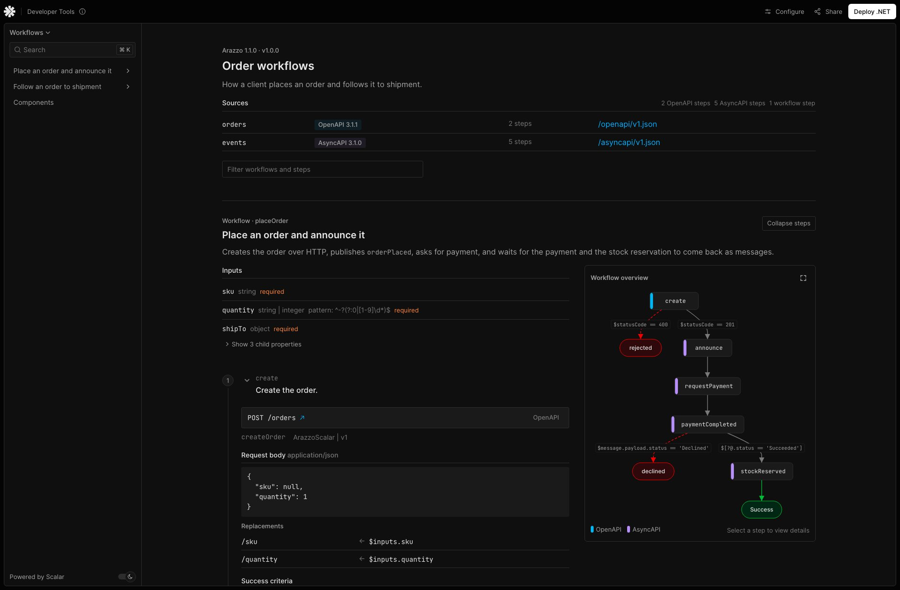
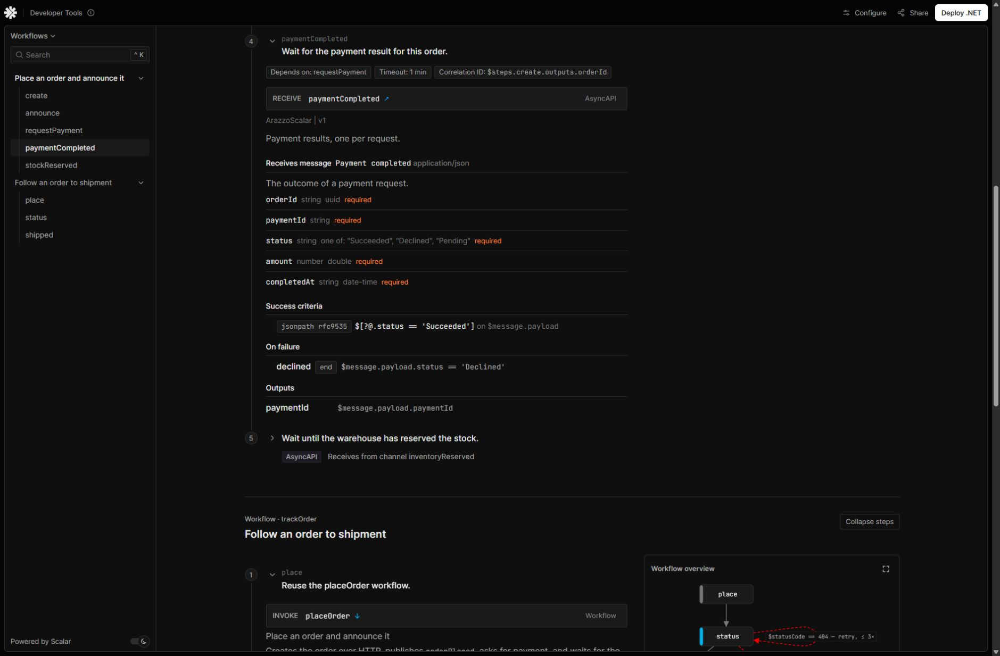
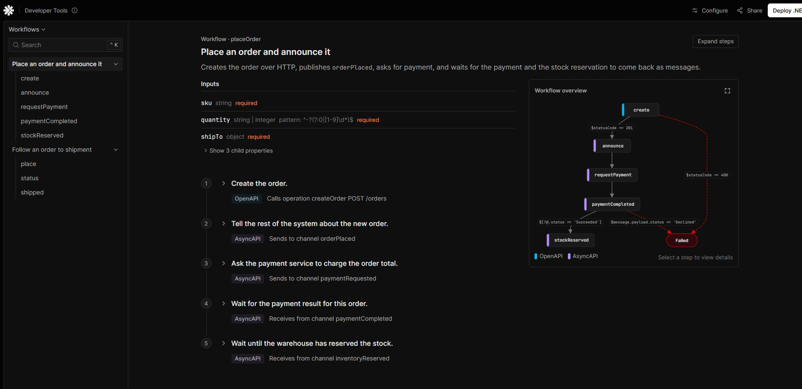
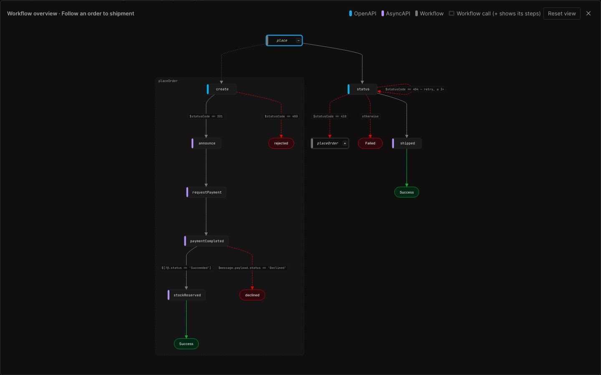
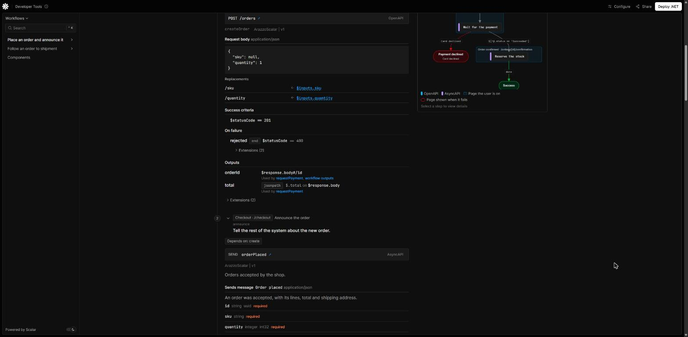
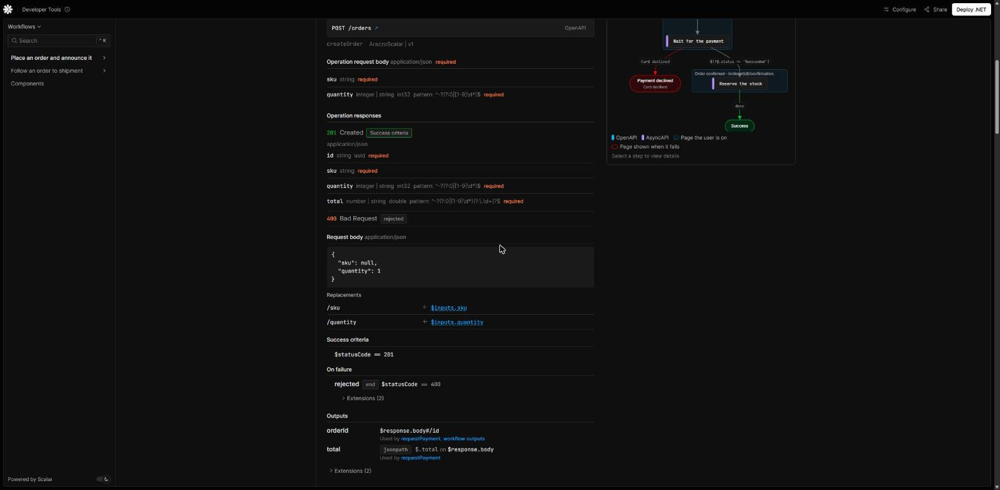
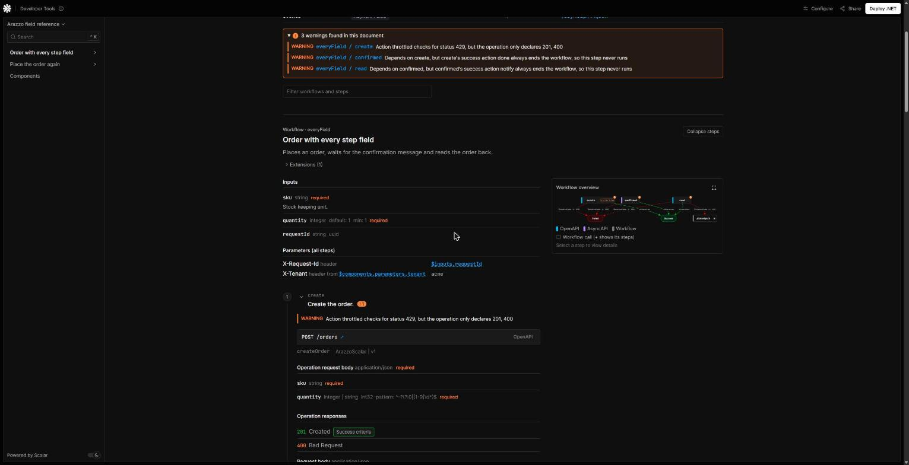
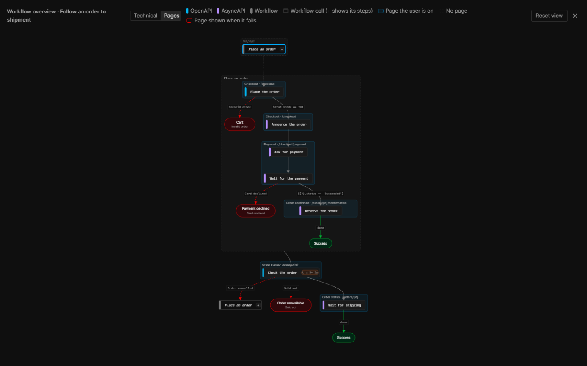

# Arazzo in Scalar

`Bielu.AspNetCore.Arazzo.Scalar` renders Arazzo documents in the [Scalar](https://scalar.com/) API
Reference, on the same page as the OpenAPI and AsyncAPI documents their steps call.



> [!IMPORTANT]
> The plugin uses Scalar's plugin `documentTypes` API, first released in `@scalar/api-reference` 1.80.0
> ([scalar/scalar#10816](https://github.com/scalar/scalar/pull/10816)). `Scalar.AspNetCore` bundles that version from
> 3.0.1 on, and this package depends on it. Older Scalar versions ignore the plugin and show an Arazzo source as an
> empty OpenAPI document.

## Setup

```sh
dotnet add package Bielu.AspNetCore.Arazzo.Scalar
```

```csharp
builder.Services.AddArazzo(options =>
{
    options.WithInfo("Order workflows", "1.0.0");
    options.AddOpenApiSource("orders", "v1");
    options.AddAsyncApiSource("events", "v1");
    options.AddWorkflow("placeOrder", workflow => workflow
        .Step("create", step => step.Operation("createOrder"))
        .Step("announce", step => step.Channel("events", "orderPlaced", ArazzoStepAction.Send)));
});

var app = builder.Build();

app.MapOpenApi();
app.MapAsyncApi();
app.MapArazzo();
app.MapScalarArazzoAssets();

app.MapScalarApiReference(options => options
    .AddDocument("v1", "Orders")
    .AddAsyncApiDocument("v1", "Events")
    .AddArazzoDocument("v1", "Workflows")
    .WithArazzo());
```

`AddArazzoDocument` adds the document `MapArazzo()` serves (`/arazzo/{documentName}.json` by
default) as a Scalar source. `WithArazzo` adds the plugin script, which `MapScalarArazzoAssets`
serves from `/bielu/scalar/arazzo/plugin.js`.

### Options

`WithArazzoOptions` enables the view like `WithArazzo`, with options:

```csharp
app.MapScalarApiReference(options => options
    .AddArazzoDocument("v1", "Workflows")
    .WithArazzoOptions(arazzo =>
    {
        arazzo.EndLabelExtension = "x-page";   // name end nodes after this extension of the end action
        arazzo.AssetsPath = "/bielu/scalar/arazzo";
    }));
```

| Option | Default | Effect |
| --- | --- | --- |
| `EndLabelExtension` | none | A specification extension (`x-…`) on `end` failure actions whose value names the end node they lead to in the workflow overview, in place of the action's name. Actions without it keep their name. |
| `PagesExtension` | none | [Pages view](#pages-view): a document-level extension holding the map of pages. |
| `PageExtension` | none | Pages view: the extension naming the page of a step (the user is on it) or of an action (they land on it). May be the same key as `EndLabelExtension`. |
| `LabelExtension` | none | Pages view: the extension holding a plain-language label on workflows, steps and actions. |
| `AssetsPath` | `/bielu/scalar/arazzo` | Where `MapScalarArazzoAssets` serves the script. |

The options are written to the page as `window.__BIELU_SCALAR_ARAZZO__`, which the plugin reads when it
starts. With the npm package, pass them to `createArazzoPlugin({ endLabelExtension: 'x-page' })`; with
Scalar's `pluginUrls`, put them on the module URL (`scalar-plugin.mjs?endLabelExtension=x-page`). Every
option except `AssetsPath` names a specification extension and must start with `x-`.

## What is rendered

Step targets emphasize the HTTP method and path or channel action and address. Source versions remain
in the Sources table and target tooltips; steps use compact spec labels. Message payload properties
share the page surface, and nested properties, examples and extensions use consistent disclosure controls.

An AsyncAPI step shows the message it receives, with its payload, next to the step's correlation ID,
timeout, criteria and outputs:



With its steps collapsed, a workflow reads as an outline of what each step calls:



The trackOrder workflow's overview, expanded to fill the window, with its `place` step expanded to show the
placeOrder workflow it invokes; the `cancelled` action's `goto` to placeOrder is a workflow node of its own:



- The document's `info`, its `$self` URL (Arazzo 1.1) and its `sourceDescriptions`. Each source shows its spec and version, whether
  it is loaded in the page, and how many steps use it, and the header counts the steps per spec.
- A filter box under the header that narrows the workflows and steps by id, summary, description,
  target or action (every word must match), keeping each step's number. With the [Pages view](#pages-view)
  configured, it also finds the labels, page titles and routes it shows: a step's own, and those of the
  actions it runs. Scalar's own search (Ctrl+K)
  does not index plugin documents yet.
- One sidebar entry per workflow, with one child entry per step. Sidebar clicks, deep links and
  scroll position stay in sync, as they do for operations.
- For each workflow: its inputs (nested properties fold out), shared parameters, steps, success
  and failure actions, and outputs.
- A workflow overview beside the steps: a flowchart of the steps, with arrows for `dependsOn` (or
  document order) and labeled success and failure branches for `onSuccess`/`onFailure`: each branch
  shows its criteria, and an action without criteria (the catch-all) reads "otherwise"; hovering a
  branch's label shows the action's name. Drag to pan,
  scroll to zoom, click a step to jump to it, or expand it to fill the window. It follows Scalar's
  light and dark themes. From the keyboard, the focused overview pans with the arrow keys, zooms with
  `+`/`-` and resets with `0`; Tab reaches each step box, and Enter opens the step: its section unfolds,
  scrolls into view and takes keyboard focus. A step inside an expanded workflow opens in that workflow's
  own section, and a step the filter hides is shown until the filter changes. Each step box has a
  colored marker for the spec its target is described in, explained by a legend in the corner.
  - **Actions.** A step's branches are the actions Arazzo runs for it: its own `onSuccess`/`onFailure`
    plus the workflow's `successActions`/`failureActions`, which apply to every step. A step that declares
    an action with the same name overrides the workflow's for that step only. A success action without
    criteria always applies, so no arrow continues to the next step in document order after it.
  - **Order.** The boxes under a step are always in the same order: its failure paths on the left, in the
    order of its `onFailure` actions (so a `retry` through a workflow and the end nodes appear as written),
    then the steps it continues to (`dependsOn`, document order, or a `goto`), and Success on the right. The
    same rule holds inside an expanded workflow, and expanding or collapsing one never reorders the boxes
    beside it.
  - **Ends.** `end` success actions lead to one Success node, and so does the last step (or a step no
    other step depends on) unless one of its success actions always applies (has no criteria), since Arazzo ends a workflow
    successfully after its last step; that arrow is labeled with the step's success criteria when they
    are short. `end` failure actions lead to one Failed node while they can't be told apart; when they
    have different names, each gets its own end node named after the action, or after the value of the
    extension set with [`EndLabelExtension`](#options).
  - **Retries.** A `retry` through another step gets an arrow to that step and one back, since the
    retrying step runs again afterwards. A `retry` of the step itself (no `stepId` or `workflowId`) is a
    `↻` badge on the step's box with its limit and delay (`↻ ≤ 3× 2s`); hovering the box lists its
    criteria.
  - **Workflows.** A workflow that a step invokes (`workflowId`), or that a `goto`/`retry` action invokes,
    is a node of its own, drawn with a thick outline and listed in the legend. Actions invoking the same
    workflow share one node. A `retry` through a workflow gets an arrow to the workflow node, labeled with
    its criteria and limit (`$statusCode == 401 — retry, ≤ 1×`), and an arrow back to the step, which runs
    again afterwards; a `goto` gets only the arrow there. When the retried workflow is expanded, the arrow
    back starts at its own Success node, where control returns to the step.
  - **Expanding workflows.** A workflow node whose workflow is found has a `+` button (Tab reaches it, Enter
    or Space presses it): it shows that workflow's steps inside the diagram, in a box of their own entered
    from the workflow node, with their own arrows and ends. Workflows inside it expand the same way. A
    workflow that is already expanded further up the path is not expanded again: it is marked `↻` (a cycle).
    `−` hides the steps again, along with anything expanded inside them. The workflow's steps open below its
    node, which stays where it was under the pointer; the zoom is kept (the overview is scaled to fit only
    when it is shown, reset or resized), and the full-window view stays open. While a workflow is expanded,
    the overview beside the steps may grow to the height of the window, and pans beyond that.
  - **Workflows of other documents.** A call such as `$sourceDescriptions.identity.signIn` expands too when
    the Arazzo document that source names is loaded on the same Scalar page, for example a second Arazzo
    source published by the service that owns the workflow. A qualified call always goes to that document,
    even when this one has a workflow with the same id. Its steps resolve in their own document: its
    reusable actions, its page registry in the Pages view, and its step targets. The cycle check counts the
    document as well as the workflow, so a call back into this document is marked `↻`. The group is labelled
    with the readable form, `identity.signIn`, and so is the node when the document isn't loaded, in which
    case it can't be expanded. Boxes inside it have no step section on this page, so they don't open one. The document may load after this one: the view keeps checking until every source, and every Arazzo source of the
    documents those lead to, is loaded. A relative source URL resolves against the document's `` when it has one,
    as Arazzo specifies, else against the URL it was loaded from. The step badge shows the called document's Arazzo
    version, and the step counts under that source in Sources.
- For each step: the operation, channel or workflow it targets, with that target's description and
  its own parameters. A step that invokes a workflow has a "Show its steps" button that lists that
  workflow's steps (each with what it calls) under the target, read-only and one level deep. This includes a
  workflow of another loaded Arazzo document. The target link goes to the workflow itself, in its own
  document when it is another one. An AsyncAPI step also shows the message it sends or receives: its payload as
  a property list (references followed into the AsyncAPI document), its content type, and its first
  example payload; a payload in another schema format, such as Avro, is shown as written. An OpenAPI step
  shows what its operation accepts and returns: the request body schema (in the media type the step sends,
  with the others named), and each response by status, its schema, example and headers folding out. A
  response the step's success criteria check for (`$statusCode == 201`) is marked "Success criteria", and
  one an action's criteria check is marked with the action's name; a `4XX` range counts only for codes the
  operation doesn't declare on their own. Swagger 2.0 body parameters and response schemas are read too. Then come
  the step's parameters, request body, success criteria,
  `onSuccess`/`onFailure` actions and outputs. Arazzo 1.1 steps also show their `timeout` and
  `correlationId`. A criterion that isn't a simple condition is labeled with its language
  (`regex`, `jsonpath`, `xpath`, plus the version when given) and the context it reads, and an
  action that starts a workflow lists the `parameters` it passes. A request body lists its
  `replacements` (target, its selector type, and the value written there). Wherever a value can be
  an Arazzo 1.1 Selector Object (outputs, parameters, replacements), it reads as
  "`$.lines[0]` on `$response.body`" with its language as a badge, rather than as raw JSON. Reusable objects (`$components.parameters.*` and the
  like) are resolved, and a parameter that came from one says which (`from $components.parameters.tenant`).
- Runtime Expressions link to what they read, wherever they appear: in parameters, request bodies,
  replacements, criteria, actions, outputs and `correlationId`. `$inputs.<name>` goes to the workflow's
  input, `$steps.<id>.outputs.<name>` to that step's output (opening the step first),
  `$workflows.<id>.outputs.<name>` to that workflow's output, and `$components.<kind>.<name>` to the
  component. The row it lands on is highlighted for a moment. An expression that names an input,
  step, output, workflow, component or source description the document doesn't declare is underlined
  in red, with the reason in its tooltip. Each output lists the steps that read it ("Used by
  requestPayment, workflow outputs"), and a workflow output lists the steps of other workflows that do.

  

  

- Each step target is labeled with its spec: `OpenAPI`, `AsyncAPI` or `Workflow`, with the version in its tooltip and the Sources table. Channel
  steps also say whether they send or receive. See [Which spec a step targets](#which-spec-a-step-targets).
- The reusable `components` (input schemas, parameters, success and failure actions) in a section
  of their own after the workflows, with a sidebar entry.
- Specification Extensions (`x-*` fields) on the document, `info`, source descriptions, workflows,
  steps, request bodies, actions and components, in a collapsed "Extensions" list. Scalar's own
  `x-scalar-*` fields are left out.
- Each step can be collapsed with the chevron beside its heading, and a workflow's "Collapse steps"
  button folds all of its steps at once. A collapsed step still shows a one-line summary of what it
  targets (spec, action and target), and clicking a step in the overview opens it.
- Problems the view can find on its own are listed under the header ("1 error · 3 warnings found in this
  document"), each linking to its step; listed again at the top of the step, counted beside its heading, and
  marked on its box in the overview. Errors are certainly wrong: a target the loaded sources don't declare, a
  source description, workflow or step that doesn't exist (in a target, `goto`, `dependsOn` or Runtime
  Expression), a required path parameter that isn't passed, or a duplicate `stepId`. Warnings are likely
  mistakes: a parameter the operation doesn't declare (headers aren't checked), a required query parameter
  that isn't passed, a status the criteria check that the operation doesn't return, a step that depends on
  one whose success always ends the workflow (so it never runs), and an expression that reads a step that
  doesn't run first, or a step that sends its own output. A target is only checked once the documents it
  could be in are loaded. The `ArazzoValidator` in .NET and the `BARAZZO` analyzers check the document
  itself; these checks add what only the loaded OpenAPI and AsyncAPI documents can tell.

  

- Each workflow and step heading has a copy-link button. With Scalar's `classic` layout, each
  workflow can be collapsed.

A step's target is looked up in the documents loaded in the same Scalar page. The step's
source description URL is matched against the URL each Scalar source was loaded from, so a
generated `/openapi/v1.json` source description finds the `/openapi/v1.json` Scalar source. When
the target's document is not loaded, the step still shows the raw `operationId` or path.

A resolved target is a link. It names the target (its `operationId`, or the AsyncAPI operation or
channel name) rather than the raw `{$sourceDescriptions.…}` reference, and opens it in its own
document: the OpenAPI operation, the AsyncAPI operation, or the channel. Scalar picks the document it
shows when the page loads, so following the link reloads the page at the target's deep link. Back
and Forward switch documents the same way, and Ctrl-click opens the target in a new tab. A step that
invokes another workflow links to that workflow's section. The links use the ids of Scalar's own
sidebar, so they follow any `generateOperationSlug` the page sets; they assume Scalar's default hash
routing.

The [`ArazzoScalar` example](https://github.com/bielu/Bielu.AspNetCore.ApiDescriptions/tree/main/src/examples/ArazzoScalar)
puts this together: two workflows mixing HTTP operations and messages, rendered at `/scalar`. They
are built with the fluent API, including payload replacements, Selector Object parameters and
outputs, workflow outputs a later workflow reads, and a reusable failure action. The example also
serves a hand-written "Arazzo field reference" document (`wwwroot/fixtures`) that uses every field of
Arazzo 1.1, so the view is checked against fields the example's workflows don't use. For what the
builders can and cannot produce, see [Authoring coverage](overview.md#authoring-coverage).

## Pages view

For readers who think in screens rather than operations, the workflow overview can show the pages a user
goes through. Describe the app's pages once on the document, then say which page each step is on and which
page each action lands on, with plain-language labels:

```json
{
  "arazzo": "1.1.0",
  "x-shop-pages": {
    "checkout": { "title": "Checkout", "route": "/checkout" },
    "payment": { "title": "Payment", "route": "/checkout/payment", "description": "Card details." },
    "paymentDeclined": { "title": "Payment declined", "route": "/checkout/declined" }
  },
  "workflows": [{
    "workflowId": "placeOrder",
    "x-label": "Place an order",
    "steps": [
      { "stepId": "create", "operationId": "createOrder", "x-page": "checkout", "x-label": "Place the order" },
      {
        "stepId": "paymentCompleted", "channelPath": "…", "x-page": "payment", "x-label": "Wait for the payment",
        "onFailure": [{ "name": "declined", "type": "end", "x-page": "paymentDeclined", "x-label": "Card declined" }]
      }
    ]
  }]
}
```

```csharp
app.MapScalarApiReference(options => options
    .AddArazzoDocument("v1", "Workflows")
    .WithArazzoOptions(arazzo =>
    {
        arazzo.PagesExtension = "x-shop-pages";
        arazzo.PageExtension = "x-page";
        arazzo.LabelExtension = "x-label";
    }));
```

With the fluent API, add them with `WithExtension` on the options, workflows and steps, and through an
action's `Extensions`; the [`ArazzoScalar` example](https://github.com/bielu/Bielu.AspNetCore.ApiDescriptions/tree/main/src/examples/ArazzoScalar)
does. When any of the three options is set and the document uses it, the overview (inline and full window)
gets a **Technical | Pages** toggle. Technical, the view described above, is the default; the choice applies
to every workflow on the page and is remembered in the browser.



In the Pages view:

- Steps are grouped into bands, one per page, titled with the page's title and route ("Payment ·
  /checkout/payment"). Consecutive steps on the same page share a band; steps without a page are in a muted
  "No page" band. A band never covers boxes that aren't its steps: when other boxes sit between them, each
  step gets a band of its own. An expanded workflow's steps get their own bands inside its box. A band is
  centered on its steps and as wide as its title, and the layout keeps that room free, so a long route over a
  short step stays inside its workflow's box and clear of the branch beside it. A title and route longer
  than 64 characters are cut with "…"; the band's tooltip has them in full.
- Boxes show the step's label, or its `stepId` when it has none; the `stepId` is in the tooltip. A workflow
  node shows the label (or the summary) of the workflow it calls.
- Arrows show the action's label, or its criteria (or "otherwise") when it has none. The arrow to Success
  after the last step reads "done".
- An end node is named after the page its actions land on (from `PageExtension`, or `EndLabelExtension`),
  with their label under it, when every arrow into it lands on that page; Success then shows that page
  with a ✓. When the arrows into one end node land on different pages (paid orders on Confirmation,
  pending ones on Review, or two steps' `rejected` actions on pages of their own), or one of them has no
  page (the "done" arrow after the last step), the end node keeps its generic name and each arrow ends with
  its own page ("→ Confirmation").
- Everything else is as in the Technical view: the same order, colors and arrows, and expanding and
  collapsing keeps the zoom and the node under the pointer. Switching views keeps the zoom too. The legend
  explains the bands and end pages.
- Whether the toggle appears counts the actions every step runs, so a page on a workflow-level
  `successActions`/`failureActions` entry is enough.
- The step list shows each step's page and label above its heading.

## Which spec a step targets

An Arazzo workflow can mix HTTP calls (OpenAPI) and messages (AsyncAPI), so each step says which
one it targets. The spec is worked out in this order:

1. When the target is found in a loaded document, that document's `openapi`, `swagger` or
   `asyncapi` field gives the spec and its version.
2. Otherwise the step's source description decides: the one named by
   `{$sourceDescriptions.NAME.url}#/…` or by a qualified `$sourceDescriptions.NAME.operationId`, through
   its `type`. A source without a `type` falls back to the pointer: `/paths/…` is OpenAPI, and
   `/channels/…` and `/operations/…` are AsyncAPI. A `channelPath` step is always AsyncAPI.
3. A bare `operationId` that is not loaded takes the spec all the source descriptions share. When
   they mix specs, no badge is shown.

In cases 2 and 3 the badge has a dashed border and reads "not loaded". A step that invokes another
workflow is labeled `Workflow`. The generated `sourceDescriptions` from `AddOpenApiSource` and
`AddAsyncApiSource` always set `type`, so this fallback works for them.

The spec is also shown as a color (blue for OpenAPI, purple for AsyncAPI, gray for workflows),
taken from Scalar's theme, but the badge text and the diagram's legend and tooltips always name it,
so the color is never the only cue.

## .NET Aspire

`Bielu.AspNetCore.Arazzo.Scalar.Aspire` does the same for the Scalar resource of a .NET Aspire AppHost
(`Scalar.Aspire`), where the API Reference runs in a container rather than in your app:

```sh
dotnet add package Bielu.AspNetCore.Arazzo.Scalar.Aspire
```

```csharp
var api = builder.AddProject<Projects.Orders>("api");

builder.AddScalarApiReference()
    .WithArazzo()
    .WithApiReference(api, options => options
        .AddDocument("v1", "Orders")
        .AddArazzoDocument("v1", "Workflows"));
```

`WithArazzo` registers the plugin through Scalar's `PluginUrls` option, which loads it as an ES module
before the API Reference mounts, so the container keeps its own Scalar bundle. By default the module is
`dist/scalar-plugin.mjs` from jsDelivr, pinned to the `@bielu/scalar-arazzo` version released with the
package; pass `pluginUrl:` to load it from somewhere else. `AddArazzoDocument` adds the document the API
serves with `MapArazzo()` (`/arazzo/{documentName}.json` by default) as a source of that API reference,
next to its OpenAPI and AsyncAPI documents. The app itself doesn't need `Bielu.AspNetCore.Arazzo.Scalar`
for this: the container renders the documents.

To set the [options](#options) (`EndLabelExtension` and the Pages view's `PagesExtension`,
`PageExtension` and `LabelExtension`), call `WithArazzoOptions` instead of `WithArazzo`:

```csharp
builder.AddScalarApiReference()
    .WithArazzoOptions(arazzo =>
    {
        arazzo.PagesExtension = "x-shop-pages";
        arazzo.PageExtension = "x-page";
        arazzo.LabelExtension = "x-label";
    })
    .WithApiReference(api, options => options.AddArazzoDocument("v1", "Workflows"));
```

The module has no other way to receive them, so they go in the query string of its URL
(`scalar-plugin.mjs?pagesExtension=x-shop-pages&…`). `arazzo.PluginUrl` replaces the default URL; its
own query parameters and fragment are kept. With no options set, the URL is the one `WithArazzo` uses.

Every way of setting the options (`WithArazzoOptions` in the app or the AppHost, `createArazzoPlugin`,
the page global and the module URL) accepts the same names: `x-` followed by a name. .NET throws for
anything else, such as `x-` alone or `page`; the JavaScript entry points ignore it.

> [!IMPORTANT]
> The plugin needs `@scalar/api-reference` 1.80.0 or later in the Scalar container image. The package depends on
> Scalar.Aspire 1.0.2 or later, whose image ships 1.81.0; Scalar.Aspire 0.15.0 and earlier ship an older one,
> which shows an Arazzo source as an empty OpenAPI document.

## Without ASP.NET Core

The bundle is also published to npm as `@bielu/scalar-arazzo`. [Arazzo for Scalar](../npm/scalar-arazzo.md)
walks through it from a JavaScript app, with its options and other entry points:

```ts
import { createArazzoPlugin } from '@bielu/scalar-arazzo'

Scalar.createApiReference('#app', {
  sources: [
    { title: 'Pets', url: '/openapi/v1.json' },
    { title: 'Workflows', url: '/arazzo/v1.json' },
  ],
  plugins: [createArazzoPlugin()],
})
```

`dist/scalar-plugin.mjs` can be passed to Scalar's `pluginUrls` instead.

Each Scalar reference keeps its own Arazzo plugin options. Multiple references on the same page can use different extension names. Retry paths show the fallback action reached when the retry limit is exhausted.
