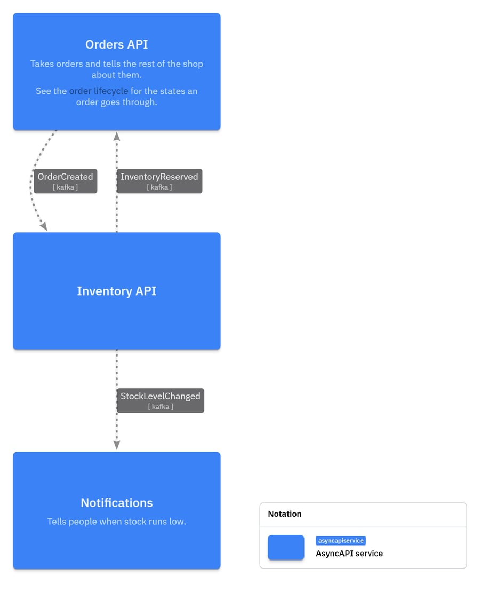

# LikeC4 architecture models

[LikeC4](https://likec4.dev) describes software architecture as code: elements, the relationships between them, and
views, in `.c4` files that its tools render as diagrams, export (PNG, Mermaid, D2, draw.io) and check.
`Bielu.AspNetCore.AsyncApi.LikeC4` writes such a model from your AsyncAPI documents, so the diagram of who sends
what to whom follows the code instead of being drawn by hand. Arazzo workflows over those services become
[dynamic views](#arazzo-workflows-as-dynamic-views).

## Generating a model

Write each service's AsyncAPI document (for example with [build-time generation](build-time-generation.md)), then
generate one model from all of them with the [CLI](cli.md#likec4):

```bash
dotnet asyncapi likec4 \
  --source orders=src/Orders/obj/orders.asyncapi.json \
  --source inventory=https://inventory.example.com/asyncapi/v1.json \
  --source notifications=docs/notifications.asyncapi.yaml \
  --output architecture/asyncapi.c4

npx likec4 start architecture                       # browse it
npx likec4 export png -o docs/architecture architecture   # or render every view
```

Or call the generator yourself; it is framework-free:

```csharp
using Bielu.AspNetCore.AsyncApi.LikeC4;

var model = AsyncApiLikeC4Generator.Generate(
[
    new AsyncApiLikeC4Source("orders", File.ReadAllText("orders.asyncapi.json"))
    {
        Link = "https://orders.example.com/asyncapi/v1.json",
    },
    new AsyncApiLikeC4Source("inventory", File.ReadAllText("inventory.asyncapi.json")),
]);
Directory.CreateDirectory("architecture");
File.WriteAllText("architecture/asyncapi.c4", model);
```

Documents may be AsyncAPI 2.x or 3.x, JSON or YAML.

## What the model contains

| AsyncAPI | LikeC4 |
| --- | --- |
| each document | an `asyncapiService` element, titled by `info.title`, described by `info.description` (Markdown), linking to the document |
| each channel | an `asyncapiChannel` element (a queue), one per **address** across every document, with the protocols of its servers as its technology |
| a `send` operation | a relationship `service -[asyncapiSend]-> channel 'sends OrderCreated'` |
| a `receive` operation | a relationship `channel -[asyncapiReceive]-> service 'delivers OrderCreated'`, in the direction the message travels |
| a sender and a receiver of the same messages on a channel | a flow `sender -[asyncapiFlow]-> receiver 'OrderCreated'` |

Because channels are matched by address, the service that sends to `orders.created` and the one that receives from
it meet at the same element, and the flow between them follows. A channel whose address is unknown (3.x allows
leaving it out) stays the document's own. In AsyncAPI 2.x a channel's `publish` operation is what clients publish,
so it is read as the service receiving, and `subscribe` as the service sending.

Every element carries metadata for tools and for your own files: a service's `asyncapi` (the source's name) and
`version`, a channel's `asyncapiChannel` (its address), and a send or receive's `asyncapiOperation`.

The model has three kinds of view:

| View | Shows |
| --- | --- |
| `asyncapiChannels` | every service and channel, with the sends and receives |
| `asyncapiServices` | the services alone, joined by their flows |
| `asyncapi<Service>` (one per service) | the service and the channels it sends to and receives from |

The `asyncapiChannels` view of a three-service shop, and its `asyncapiServices` view: sends are solid, deliveries
dashed, flows dotted.




### Element ids

A service's id is its source name in camelCase (`orders-api` becomes `ordersApi`), and a channel's is its address
the same way (`orders.created` becomes `ordersCreated`). An id that would be a LikeC4 keyword (`model`, `views`, …)
or is already taken gets a number (`model2`), and one that would start with a digit is prefixed (`service1st…`).
The ids only change when the names and addresses they come from do, with one exception: when two names come out the
same (`orders-api` and `orders.api` are both `ordersApi`), the number goes to whichever is generated second, so
reordering the sources swaps the ids, and an `extend ordersApi` of your own then describes the other service. Keep
source names distinct after camelCasing.

## Arazzo workflows as dynamic views

Arazzo documents add a [dynamic view](https://likec4.dev/dsl/views/dynamic/) per workflow, drawn as a sequence
diagram on the same elements:

```bash
dotnet asyncapi likec4   --source orders=obj/orders.asyncapi.json --source inventory=obj/inventory.asyncapi.json   --arazzo docs/checkout.arazzo.yaml   --output architecture/asyncapi.c4
```

```csharp
var model = AsyncApiLikeC4Generator.Generate(
    asyncApiSources,
    [new ArazzoLikeC4Source("checkout", File.ReadAllText("checkout.arazzo.yaml"))]);
```

Each step is an arrow, in the order the workflow lists its steps:

| Step | Arrow |
| --- | --- |
| an operation or channel of a source description that is one of the AsyncAPI documents | to or from the **channel** element: the workflow takes the other side of the service's operation (it sends what the service receives), or the side the step's `action` names |
| any other operation (`operationId`, `operationPath`) | to the source description's element, labelled with the operation |
| `workflowId` of a workflow in one of the Arazzo documents | a step that opens that workflow's view (`navigateTo`) |
| `workflowId` of a workflow not given | to the Arazzo source description's element |

A source description is one of the AsyncAPI documents when its `name` is the document's name, or its `url` is the
document's link (`--link`, or the URL it was read from). Any other source description becomes an `arazzoSource`
element (one per URL, a relative one resolved against the Arazzo document's `$self` or link), with its type
(`OpenAPI`, `AsyncAPI`, `Arazzo`) as its technology. A bare `operationId` belongs to the AsyncAPI document that has
the operation, else to the first source description that is not an Arazzo document. A step naming no source
description that is in the document is left out.

Arazzo has no field for who makes a step's call, so every arrow starts at the client (an `arazzoActor` element). As
in the [Scalar Arazzo plugin's sequence view](arazzo/scalar.md), `x-actor` on a step or its workflow names someone
else: a source description (its element), or anyone (an `arazzoActor` of their own). The document's `x-actors`
registry titles and describes them, and its entry with `"client": true` names the client. Documents share an actor
whose entries match; when two documents title or describe the same actor differently, each gets an element of its own:

```yaml
x-actors:
  shopper: { title: Shopper, description: Buys things in the web shop., client: true }
  warehouse: { title: Warehouse staff }
workflows:
  - workflowId: placeOrder
    steps:
      - stepId: restock
        x-actor: warehouse
        operationId: publishStockLevelChanged
```

A workflow's view is `arazzo<WorkflowId>` (`arazzoPlaceOrder`), titled by its `summary`; a step's `description`
becomes its notes. LikeC4's browser shows these views as sequence diagrams; `likec4 export png --seq` renders them
that way too:


## Keeping your own descriptions

The generated file is meant to be written again on every build, so do not edit it. LikeC4 reads every `.c4` file in
the workspace as one model, so describe the generated elements further in a file of your own:

```likec4
// architecture/team.c4
model {
  extend orders {
    metadata {
      owner 'checkout-team'
    }
  }
}

views {
  view checkout {
    title 'Checkout'
    include orders, inventory, ordersCreated
  }
}
```

## Checking the model in CI

LikeC4's own CLI validates the model, and its layout, in the same job that generates it:

```bash
dotnet asyncapi likec4 --source "obj/*.asyncapi.json" --output architecture/asyncapi.c4
npx likec4 validate architecture
git diff --exit-code architecture/asyncapi.c4   # fail when the committed model is out of date
```

A model written by hand is checked against the documents with [`likec4 check`](#checking-a-hand-written-model).

## Checking a hand-written model

Teams often draw their architecture first, by hand, at a level the generated model does not: systems, containers,
the databases next to them. `dotnet asyncapi likec4 check` keeps such a model honest against the AsyncAPI documents.
Map its elements to them with the same metadata the generated model carries, then check it in CI:

```likec4
model {
  shop = system 'Shop' {
    orders = service 'Orders' {
      metadata {
        asyncapi 'orders'                // stands for the AsyncAPI document named orders
      }
      api = service 'Orders API'        // inside orders, so it stands for it too
    }
    inventory = service 'Inventory' {
      metadata {
        asyncapi 'inventory'
      }
    }
  }
  ordersCreated = topic 'orders.created' {
    metadata {
      asyncapiChannel 'orders.created'  // stands for the channel at this address
    }
  }

  shop.orders.api -> ordersCreated 'publishes'
  shop.inventory -> ordersCreated 'subscribes'
}
```

```bash
npx likec4 export json -o likec4.json architecture
dotnet asyncapi likec4 check --model likec4.json   --source orders=obj/orders.asyncapi.json --source inventory=obj/inventory.asyncapi.json
```

The check reads the model as LikeC4 exports it, so it sees the whole workspace (every file, `extend` included) the
way LikeC4 does. It reports, as errors:

| Finding | When |
| --- | --- |
| a relationship with no operation behind it | a service–channel relationship whose service neither sends to nor receives from the channel, or a service–service one where neither sends messages to a channel the other receives them from |
| a missing relationship | a service sends to or receives from a channel the model has, with no relationship between them; or two services exchange messages through a channel the model leaves out, with no relationship between them |
| metadata naming nothing | `asyncapi` naming a document that is not checked, or `asyncapiChannel` an address no document declares |

A hand-written model of the shop, with what the check finds marked in red:


1. `Billing` stands for an AsyncAPI document that is not checked.
2. `payments.done` stands for an address no document declares.
3. `notifies`: Orders sends nothing that Notifications receives.
4. Inventory sends `StockLevelChanged` to Notifications through `inventory.stock-changed`, a channel the model leaves
   out, and the model has no relationship between them.

`Orders API -> orders.created` counts as a relationship of `Orders`, and `Orders -> Orders database` is not checked.

Either direction of a relationship counts, since C4 models draw both data flow (`orders -> topic`) and dependency
(`inventory -> topic 'subscribes'`). Relationships with elements that stand for neither, such as databases, are not
checked. A document no element stands for is a warning, which `--strict` makes an error.

The checker is in the package too, for a test of your own:

```csharp
var findings = LikeC4ModelChecker.Check(File.ReadAllText("likec4.json"), sources);
findings.Where(finding => finding.Severity == LikeC4CheckSeverity.Error).ShouldBeEmpty();
```
