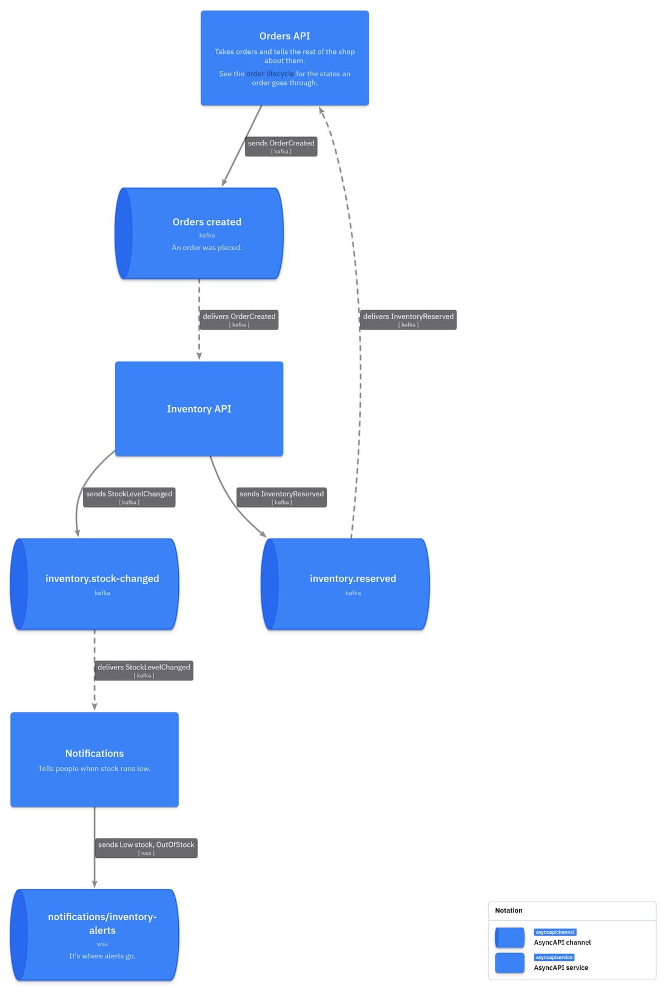

# LikeC4 architecture models

[LikeC4](https://likec4.dev) describes software architecture as code: elements, the relationships between them, and
views, in `.c4` files that its tools render as diagrams, export (PNG, Mermaid, D2, draw.io) and check.
`Bielu.AspNetCore.AsyncApi.LikeC4` writes such a model from your AsyncAPI documents, so the diagram of who sends
what to whom follows the code instead of being drawn by hand.

## Generating a model

Write each service's AsyncAPI document (for example with [build-time generation](build-time-generation.md)), then
generate one model from all of them with the [CLI](cli.md#likec4):

```bash
dotnet asyncapi likec4 \
  --source orders=src/Orders/obj/orders.asyncapi.json \
  --source inventory=https://inventory.example.com/asyncapi/v1.json \
  --source notifications=docs/notifications.asyncapi.yaml \
  --output architecture/asyncapi.c4

npx likec4 start architecture                       # browse it
npx likec4 export png -o docs/architecture architecture   # or render every view
```

Or call the generator yourself; it is framework-free:

```csharp
using Bielu.AspNetCore.AsyncApi.LikeC4;

var model = AsyncApiLikeC4Generator.Generate(
[
    new AsyncApiLikeC4Source("orders", File.ReadAllText("orders.asyncapi.json"))
    {
        Link = "https://orders.example.com/asyncapi/v1.json",
    },
    new AsyncApiLikeC4Source("inventory", File.ReadAllText("inventory.asyncapi.json")),
]);
Directory.CreateDirectory("architecture");
File.WriteAllText("architecture/asyncapi.c4", model);
```

Documents may be AsyncAPI 2.x or 3.x, JSON or YAML.

## What the model contains

| AsyncAPI | LikeC4 |
| --- | --- |
| each document | an `asyncapiService` element, titled by `info.title`, described by `info.description` (Markdown), linking to the document |
| each channel | an `asyncapiChannel` element (a queue), one per **address** across every document, with the protocols of its servers as its technology |
| a `send` operation | a relationship `service -[asyncapiSend]-> channel 'sends OrderCreated'` |
| a `receive` operation | a relationship `channel -[asyncapiReceive]-> service 'delivers OrderCreated'`, in the direction the message travels |
| a sender and a receiver of the same messages on a channel | a flow `sender -[asyncapiFlow]-> receiver 'OrderCreated'` |

Because channels are matched by address, the service that sends to `orders.created` and the one that receives from
it meet at the same element, and the flow between them follows. A channel whose address is unknown (3.x allows
leaving it out) stays the document's own. In AsyncAPI 2.x a channel's `publish` operation is what clients publish,
so it is read as the service receiving, and `subscribe` as the service sending.

Every element carries metadata for tools and for your own files: a service's `asyncapi` (the source's name) and
`version`, a channel's `asyncapiChannel` (its address), and a send or receive's `asyncapiOperation`.

The model has three kinds of view:

| View | Shows |
| --- | --- |
| `asyncapiChannels` | every service and channel, with the sends and receives |
| `asyncapiServices` | the services alone, joined by their flows |
| `asyncapi<Service>` (one per service) | the service and the channels it sends to and receives from |

The `asyncapiChannels` view of a three-service shop, and its `asyncapiServices` view: sends are solid, deliveries
dashed, flows dotted.




### Element ids

A service's id is its source name in camelCase (`orders-api` becomes `ordersApi`), and a channel's is its address
the same way (`orders.created` becomes `ordersCreated`). An id that would be a LikeC4 keyword (`model`, `views`, …)
or is already taken gets a number (`model2`), and one that would start with a digit is prefixed (`service1st…`).
The ids only change when the names and addresses they come from do, with one exception: when two names come out the
same (`orders-api` and `orders.api` are both `ordersApi`), the number goes to whichever is generated second, so
reordering the sources swaps the ids, and an `extend ordersApi` of your own then describes the other service. Keep
source names distinct after camelCasing.

## Keeping your own descriptions

The generated file is meant to be written again on every build, so do not edit it. LikeC4 reads every `.c4` file in
the workspace as one model, so describe the generated elements further in a file of your own:

```likec4
// architecture/team.c4
model {
  extend orders {
    metadata {
      owner 'checkout-team'
    }
  }
}

views {
  view checkout {
    title 'Checkout'
    include orders, inventory, ordersCreated
  }
}
```

## Checking the model in CI

LikeC4's own CLI validates the model, and its layout, in the same job that generates it:

```bash
dotnet asyncapi likec4 --source "obj/*.asyncapi.json" --output architecture/asyncapi.c4
npx likec4 validate architecture
git diff --exit-code architecture/asyncapi.c4   # fail when the committed model is out of date
```
