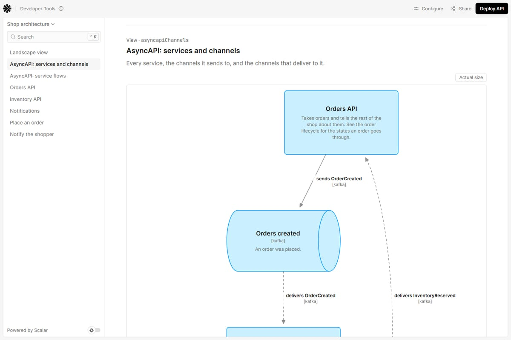
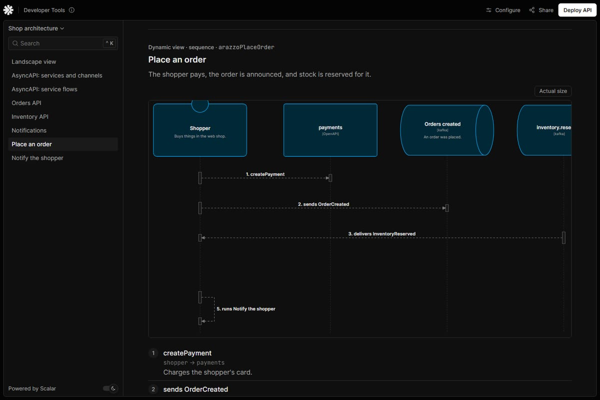

# LikeC4 for Scalar

[`@bielu/scalar-likec4`](https://www.npmjs.com/package/@bielu/scalar-likec4) is a plugin for the
[Scalar API Reference](https://github.com/scalar/scalar/tree/main/packages/api-reference). It adds a LikeC4
document type, so a [LikeC4](https://likec4.dev) architecture model sits in the same reference as the API
documents it describes:

- each view of the model gets a sidebar entry and a section;
- each view is drawn as LikeC4 laid it out, in Scalar's theme;
- an element or step that opens another view links to that view's section;
- a dynamic view with `variant sequence` is drawn as a sequence diagram, and its steps and their notes are
  listed under it.

## Requirements

- `@scalar/api-reference` **1.80.0 or later**, the first release with plugin `documentTypes`.
- The model as `likec4 export json` writes it. That file is already laid out, so the plugin draws it as it
  is and needs neither LikeC4 nor Graphviz in the browser.

```bash
npx likec4 export json -o public/architecture.likec4.json architecture
```

A model generated from AsyncAPI documents with `dotnet asyncapi likec4` is exported the same way.

## Installation

```bash
npm install @scalar/api-reference @bielu/scalar-likec4
```

```js
import { createApiReference } from '@scalar/api-reference'
import '@scalar/api-reference/style.css'
import { createLikeC4Plugin } from '@bielu/scalar-likec4'

createApiReference('#app', {
  sources: [
    { title: 'Architecture', url: '/architecture.likec4.json' },
    { title: 'Orders API', url: '/asyncapi/orders.json' },
  ],
  plugins: [createLikeC4Plugin()],
})
```

The plugin claims a source whose JSON has a `_stage`, plus `elements` and `views` keyed by id. Any other
source goes to Scalar as before.

## What it shows



- **Each view's own section.** The section has the view's title, description and links. The view is drawn in
  the shapes LikeC4 gives it (rectangles, people, queues, cylinders, browsers and others), in the view's
  colours, with `primary` following Scalar's accent colour. Relationships are drawn solid, dashed or dotted,
  as the model says.
- **Containers.** An element shown with its children is drawn as a tinted frame around them.
- **Size.** A view wider than the page is fitted to the page's width, and never shrunk below 70 %. **Actual
  size** shows it at full size, scrolling sideways.
- **Tooltips.** Hovering over an element shows its kind, technology and description.



- **Dynamic views.** A dynamic view's steps are numbered. With `variant sequence`, each element gets a lane
  with a lifeline. Each step is an arrow between activation bars, and a step back to the same element is
  drawn as a loop.
- **Step list.** Under a dynamic view, each step is listed with its source, its target and its `notes`
  (Markdown). A step with `navigateTo` links to the view it opens.

## Other ways to load the plugin

### `<script>` tag

The `<script>` bundle (`dist/plugin.js`, the package's default file on jsDelivr and unpkg) adds the plugin
to every `Scalar.createApiReference` call on the page. Load it after Scalar's own script:

```html
<div id="app"></div>
<script src="https://cdn.jsdelivr.net/npm/@scalar/api-reference@1.80.0"></script>
<script src="https://cdn.jsdelivr.net/npm/@bielu/scalar-likec4"></script>
<script>
  Scalar.createApiReference('#app', {
    sources: [{ title: 'Architecture', url: '/architecture.likec4.json' }],
  })
</script>
```

### `pluginUrls`

`dist/scalar-plugin.mjs` is an ES module whose default export is the plugin, for Scalar's `pluginUrls`:

```js
createApiReference('#app', {
  sources: [{ title: 'Architecture', url: '/architecture.likec4.json' }],
  pluginUrls: ['https://cdn.jsdelivr.net/npm/@bielu/scalar-likec4/dist/scalar-plugin.mjs'],
})
```

## Limits

- **Laid-out models only.** A model whose `_stage` is not `layouted` gets a note saying to export it with
  `likec4 export json`, and no diagrams.
- **No icons yet.** Element icons and custom images are not drawn.
- **Approximate text.** Text is wrapped by estimated width, so a long label may wrap a little differently from
  LikeC4.
